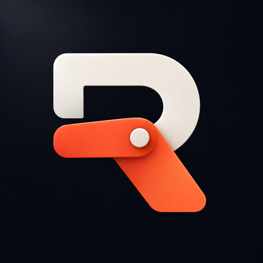

<p align="center">
  
</p>

<h1 align="center">Relaydesk</h1>

<p align="center"><strong>A self-hosted feedback desk that turns user reports into tasks your coding agents can pick up.</strong></p>

<p align="center">
  <a href="LICENSE"></a>
  
</p>

Relaydesk collects feedback from your apps and group chats, lets you triage it into a queue, and routes the work to whoever should do it — you, a cloud runner, or the Claude Code / Codex CLI on your own machine. Each project is bound to a GitHub repository, so every task carries enough context for an agent to act on it.

> [!NOTE]
> The dashboard UI is currently Chinese-only. The code, API and this README are in English; contributions for i18n are welcome.

## Features

- **Feedback intake** — an embeddable `<script>` widget (with optional screenshots and an AI clarifying question), a Telegram group bot (`/feedback`), or manual entry.
- **Triage queue** — keeps the reporter's original words separate from the confirmed requirements. Status (`triage → ready → working → review → done`) and owner (`none / human / agent`) are tracked independently, and duplicate reports can be merged into one task.
- **Human ⇄ agent handoff** — claim a task yourself, or leave it unclaimed for an agent. Leases, heartbeats and versioned requirements keep a stale agent from writing back. You can request or force a takeover at any time.
- **Local Bridge** — a single-file, zero-dependency Node client that connects your machine to Relaydesk over WebSocket. It runs Claude Code or Codex CLI against a local working directory and streams results back to the web chat.
- **Priority routing** — order local agents and cloud runners per project, with automatic fallback when a node is offline.
- **Project workspace** — a cloud file space per project (handbook, deploy runbook, files, SQLite databases) that syncs to the bridge machine.
- **Built-in MCP server** — agents can list, comment on, update and transition tasks, track releases, and run read-only queries against project datasources (SQLite, Postgres, MySQL, Redis, MongoDB).
- **Releases** — follow a release from build through deploy and verification, with checkpoints recorded by the agent.
- **PR audits & CLI Q&A** — ask the project CLI about a task, or queue an audit of the linked pull request, from an isolated runner container.
- **Wallet sign-in** — Sign-In with Ethereum (EIP-6963 + SIWE) for a single admin, with optional password login. Without it, the server only accepts loopback connections.

## Tech stack

Node.js 24 (`node:sqlite`, native TypeScript) · React Router v7 (SSR) · Tailwind CSS v4 · Vercel AI SDK · viem · `ws`

## Quick start

Requires **Node.js 24+** and **pnpm**.

```sh
pnpm install
pnpm dev
```

Open <http://127.0.0.1:8787>, create a project and enter a repository such as `your-account/your-app`.

For a production build:

```sh
pnpm build
pnpm start          # node server.ts [--host 127.0.0.1] [--port 8787] [--db data/relaydesk.sqlite3]
```

All state lives in a single SQLite file (`data/relaydesk.sqlite3` by default) and survives restarts.

## How a task flows

1. **Collect.** Paste the widget snippet from **收集入口** (Sources) into your app, run the Telegram bot, or press `N` in the dashboard.
2. **Triage.** Open the task drawer, read the original report, write the confirmed requirements, then set priority and status. Ask the project CLI to draft acceptance criteria if you like.
3. **Assign.** Click **我来处理** (I'll take it) to own the task, or mark it `ready` and leave it unclaimed for an agent.
4. **Execute.** A connected Local Bridge, a cloud runner, or the legacy `agent/relay.py` connector claims the task and works in an isolated Git worktree.
5. **Review.** When the run succeeds, the task moves to `review` with its branch and HEAD recorded. Verify, merge and close it.

## Connecting a local agent (Local Bridge)

No need to clone Relaydesk on every machine. `pnpm build` bundles `agent/bridge/` into `build/bridge/relaydesk-bridge.mjs`, and the server delivers it at `GET /api/bridge/client.mjs`, authenticated with a device bearer token and checked with `X-Content-Sha256`.

1. In **Settings → Local Agents**, click **添加本机 Agent** (Add local agent) and copy the generated onboarding prompt.
2. Paste the prompt into Claude Code or Codex in any directory. The agent checks for Node 24+, writes a `0600` config, downloads and verifies the client, and installs a background service (`launchd` on macOS, `systemd --user` on Linux).
3. In the project's routing card, bind a local working directory and order local nodes and the cloud by priority.

If you run behind a reverse proxy, allow WebSocket upgrades on `/api/bridge/ws` and keep the read timeout at 60 s or more. The server pings every 15 s.

See [Local Bridge & model routing](docs/local-bridge-and-model-routing.md) for the protocol, schema and service templates.

## Configuration

Environment variables (all optional for local use):

| Variable | Purpose |
| --- | --- |
| `PORT` | Listen port (default `8787`) |
| `RELAYDESK_ORIGIN` | Public HTTPS origin, e.g. `https://relaydesk.example.com`. Required for wallet sign-in |
| `RELAYDESK_ADMIN_WALLET` | Admin Ethereum address (EOA). Enables SIWE sign-in |
| `RELAYDESK_ADMIN_PASSWORD_SHA256` | Hex SHA-256 of an admin password. Enables password sign-in alongside the wallet |
| `RELAYDESK_ADMIN_TOKEN` | Static admin token, used when wallet mode is not configured |
| `RELAYDESK_CODEX_BIN` / `RELAYDESK_CLAUDE_BIN` | Override the CLI binaries used for chat and runs |
| `RELAYDESK_GITHUB_API_BASE` | GitHub API base URL (for GitHub Enterprise) |
| `RELAYDESK_UTILITY_AI_PROVIDER` / `_ENDPOINT` / `_MODEL` / `_API_KEY` | Small model used for titles, summaries and widget prescreening |
| `RELAYDESK_R2_*` | Cloudflare R2 bucket for widget screenshots (`ACCOUNT_ID`, `ACCESS_KEY_ID`, `SECRET_ACCESS_KEY`, `BUCKET`, `ENDPOINT`, `PUBLIC_URL`) |

Most settings, including the project CLI provider and keys, GitHub tokens, R2 and the utility model, can also be set in the dashboard. Secrets are stored server-side in `0600` files and are never sent back to the browser.

Without `RELAYDESK_ADMIN_WALLET` or `RELAYDESK_ADMIN_TOKEN`, the server only accepts requests from loopback. Put it behind an HTTPS reverse proxy before exposing it.

## Deployment

The repo ships a two-stage `Dockerfile` (the runtime image includes the Codex and Claude Code CLIs and runs as UID 10001), Compose files and a GitHub Actions workflow that tests and pushes images to GHCR.

```sh
cd deploy
echo "RELAYDESK_HOST=relaydesk.example.com" > .env
cp /path/to/your/app.env app.env           # RELAYDESK_* variables from the table above
docker compose up -d
```

[`deploy/compose.yml`](deploy/compose.yml) assumes an external Traefik `edge` network. Adapt the labels to your proxy. A daily SQLite online-backup script and systemd timer live in [`deploy/`](deploy/).

| Topic | Doc |
| --- | --- |
| Production deployment, CI images and self-iterating releases (Pier) | [docs/deployment.md](docs/deployment.md) |
| Isolated cloud runner for CLI Q&A and PR audits | [docs/project-runner.md](docs/project-runner.md) |
| Project CLI settings and public AI feedback | [docs/assistant.md](docs/assistant.md) |
| Widget and Telegram bot setup | [integrations/README.md](integrations/README.md) |
| Legacy Python worktree connector | [agent/README.md](agent/README.md) |
| Agent skill and CLI for scheduled task loops | [skills/relaydesk/README.md](skills/relaydesk/README.md) |

Some of these docs are still in Chinese.

## Project layout

```text
app/            React Router UI (dashboard, chat, settings)
server/         API, SQLite store, bridge hub, MCP server, runners, releases
server.ts       HTTP entrypoint
agent/bridge/   Local Bridge client (bundled into a single .mjs)
agent/          Legacy Python connector and cloud runner image
integrations/   Telegram bot adapter
public/         Embeddable widget, fonts, icons
skills/         Claude Code / Codex skill for autonomous task loops
deploy/         Compose files, backup script and timers
tests/          Vitest and Python unittest suites
```

## Development

```sh
pnpm typecheck
pnpm test                                   # Vitest
python3 -m unittest discover -s tests -q    # Python connector and Telegram adapter
node --check public/widget.js
pnpm build
```

## Acknowledgements

The dashboard uses self-hosted [Geist Sans and Geist Mono](https://vercel.com/geist/introduction), distributed under the [SIL Open Font License](public/fonts/OFL.txt).

## License

Relaydesk is licensed under the [MIT License](LICENSE). The bundled Geist fonts retain their separate license noted above.
